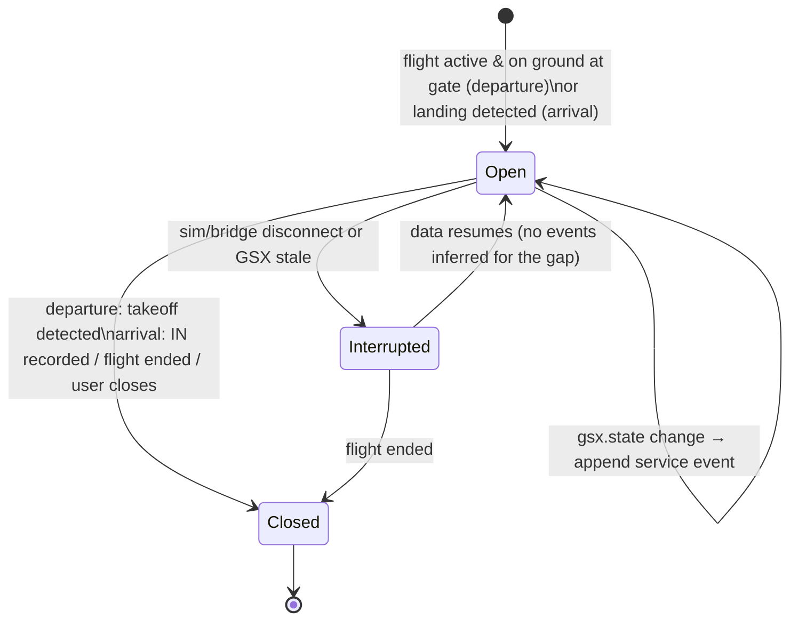
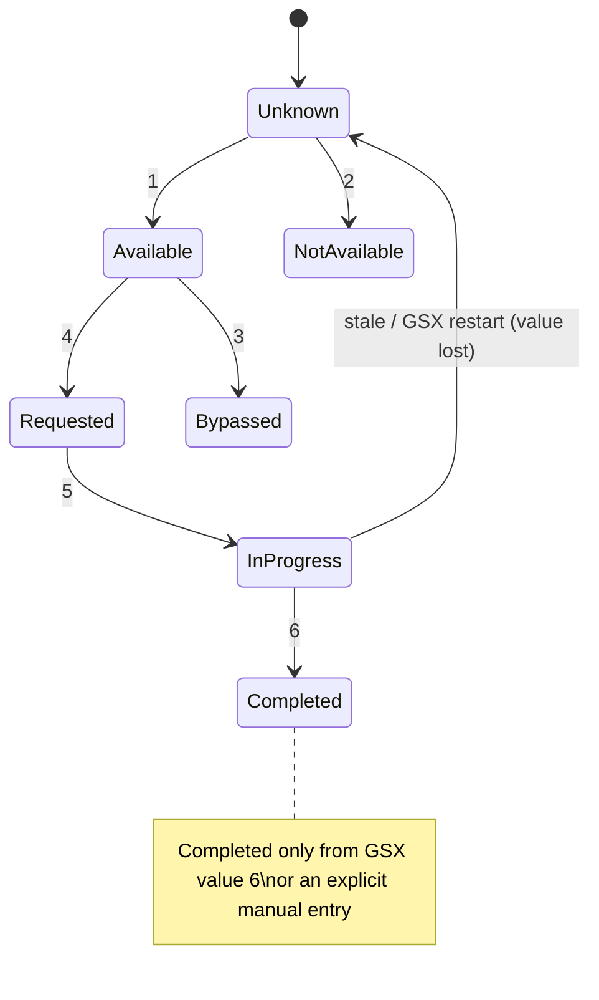

# S2-05 Phase A: GSX-connected turnaround and ground-expense ledger (proposal)

Status: **PROPOSAL — awaiting owner approval.** Nothing here is implemented, and nothing has been tested against GSX
or a simulator.

## 0. Evidence key

Every claim below carries one of these labels.

| Label | Meaning |
|---|---|
| **[OFFICIAL]** | FSDreamTeam/Virtuali's own published text: the [Couatl live-update release notes](https://www.fsdreamteam.com/couatl_liveupdate_notes.html), or the [GSX Pro product page](https://www.fsdreamteam.com/products_gsxpro.html). |
| **[MANUAL-CITED]** | The GSX manual (`GSX_manual_MSFS.pdf`, "DEVELOPERS – Interfacing with GSX", pp. 106–110; Remote API v2, pp. 266–291) as quoted by a third party. I could not read the current manual itself; it ships with GSX. |
| **[COMMUNITY]** | Forums, press articles and open-source projects. |
| **[UNVERIFIED]** | Needs the owner's installed files or a real simulator (see §8). |

## 1. Verified GSX integration interfaces

### 1.1 Interfaces GSX exposes

| Interface | What it gives | Direction | Evidence |
|---|---|---|---|
| **Service-state LVars** (see §1.2) | Per-service state enum | Read (write ignored for these) | [MANUAL-CITED] pp. 106–110, via [mrlm-net/simconnect#663](https://github.com/mrlm-net/simconnect/issues/663); values corroborated by [the GSX manual copy on PDFCoffee](https://pdfcoffee.com/gsx-manual-pdf-free.html) and [Just Flight forum](https://community.justflight.com/topic/6147/has-anyone-been-able-to-get-gsx-to-refuel-the-146) |
| **Progress LVars**: passengers boarding/deboarding (+ totals), `FSDT_GSX_BOARDING_CARGO_PERCENT`, `FSDT_GSX_DEBOARDING_CARGO_PERCENT`, fuel hose connected, fuel counter, pilots/crew on board | Progress values | Read | Cargo-percent names: [OFFICIAL] release notes 3.2.2. Other names: [MANUAL-CITED], but the issue omits their `L:`/`FSDT_GSX_` prefixes, so the exact names are **[UNVERIFIED]** |
| **Gate LVars**: `L:FSDT_GSX_SetGate_Name`, `_Number`, `_Suffix` | Selected parking position | Read | [OFFICIAL] release notes 2.6.0 |
| **Other read-only flags**: `FSDT_GSX_GPU_CONNECTED`, `FSDT_GSX_COCKPIT_DOOR_OPEN`, `FSDT_GSX_UNDERGROUND_REFUELING`, per-exit `FSDT_GSX_BOARDING_CARGO_EXIT_n` | Equipment state | Read | [OFFICIAL] release notes 3.5.3, 2.9.7 |
| **Control LVars**: `FSDT_GSX_AUTOMATION_*`, `FSDT_GSX_SET_*`, `FSDT_GSX_START_BEFORE_PUSH` | Change GSX behaviour | **Write** | [OFFICIAL]. **Out of scope:** Turnline never writes these. |
| **Couatl Remote API v2**: WebSocket, served by GSX on the local machine | Snapshot and patch state, including services with pax/cargo/fuel progress, `waitingFor` and **billing**, plus airport, parking and SimBrief. Also menu and commands. | Read **and** write | [OFFICIAL] 4.0.6 ("documented, open Remote API (v2) over a simple WebSocket… included Remote API guide"); 4.0.8, 4.0.9 settable properties. Port 8744 and field names (`state.services[].detail`, …): [COMMUNITY] [WingLog PR #62](https://github.com/Catalyst4K/WingLog/pull/62). Schema **[UNVERIFIED]**: we haven't read the guide. |
| **HTML invoices** in `%APPDATA%\Virtuali\GSX\Receipts\<group>\` (Fuel, Catering, Handling, PassengerBus) | Itemized invoice per paid service | Read (files) | [OFFICIAL] 4.0.0 (May 18, 2026). Layout **[UNVERIFIED]**. |
| **Handler-script hooks** (`getServicePricing`, `getServiceInvoiceGroup`, `getAirportCurrency`) | Pricing overrides inside GSX | GSX-side Python | [OFFICIAL]. Not an external API, so not used. |

Service-state LVar values [MANUAL-CITED]: **1** = can be called, **2** = not available, **3** = bypassed,
**4** = requested, **5** = being performed, **6** = completed. Any other value is malformed.

### 1.2 Answers to the A1 questions

- **Which documented LVars expose service status and boarding progress.** The six state LVars are
  `L:FSDT_GSX_BOARDING_STATE`, `_DEBOARDING_STATE`, `_CATERING_STATE`, `_REFUELING_STATE`, `_DEPARTURE_STATE`
  (pushback) and `_DEICE_STATE`. Boarding progress comes from the passenger-count LVars, whose exact names must be
  copied from the installed manual (§8, step M1).
- **How the bridge can read them in MSFS 2020.** Add plain `L:NAME` datums with unit `number` to a **separate**
  SimConnect data definition (see §3). Developer reports say `AddToDataDefinition` accepts `L:` names in MSFS 2020/2024
  ([devsupport](https://devsupport.flightsimulator.com/t/how-to-access-scoped-lvars-l-with-simconnect/12540),
  [MSFS forums](https://forums.flightsimulator.com/t/simconnect-wasm-combined-project-using-vs2019/486871/17)).
  One reply disputes this, so it is **[UNVERIFIED] until the owner test (§8, step S1)**. Scoped `L:1:` variables are
  unreliable; GSX's documented names are unscoped.
- **Detecting GSX availability and version.**
  - There is no documented version LVar. The GSX menu shows the installed version [OFFICIAL 3.5.3].
  - Availability is inferred, never assumed:
    - the Remote API answers on its port;
    - **and/or** the state LVars change from their initial value. An undefined LVar reads 0, which is not a valid
      state.
  - The version is recorded only if the Remote API reports it **[UNVERIFIED]**; otherwise it is "unknown".
- **Unavailable, stale or malformed data.**
  - Every GSX value goes through a quality field, the same pattern as telemetry: `ok | unavailable | invalid | stale`.
  - 0, or a value outside 1–6, is `unavailable`/`invalid`, never a state.
  - No update for more than N seconds while the simulator is connected, or the simulator disconnected, gives
    `stale`. No transitions are inferred during staleness.
- **Whether service commands are officially supported and safe.**
  - Supported, yes: the Remote API v2 and the `FSDT_GSX_SET_*`/`AUTOMATION_*` LVars are documented.
  - Not yet appropriate for Turnline. Phase B is **read-only**, as the brief requires. Commands would interfere with
    the pilot's own GSX use and add-on aircraft integrations (e.g. Fenix, PMDG).
- **Whether GSX's economy system has a documented programmatic interface.**
  - Externally, only two exist: the Remote API's per-service `billing` detail (live billing) and the HTML files.
  - There is no documented invoice export, JSON or database. The 4.0.0 notes mention "live billing on the status page"
    with rates that "should match the eventual receipt".
  - So the **final invoice file is the authoritative amount**, and live billing is only an estimate.

## 2. Billing files

### 2.1 What is documented [OFFICIAL, 4.0.x notes]

- **Location and groups:** `%APPDATA%\Virtuali\GSX\Receipts\<group>\`, with groups Fuel, Catering, Handling,
  PassengerBus.
- **Services billed:** fuel, catering, pushback, GPU, jetway, stairs, boarding, deboarding, water, lavatory, bus,
  de-icing.
- **Format:**
  - HTML, "NATA-style with operator letterhead, line items, and itemised taxes";
  - the fuel PRODUCT TYPE row shows density, e.g. "Jet-A1 @ 0.80 kg/L (6.70 lb/gal)";
  - the handling invoice has cargo manifest lines (4.0.19).
- **Timing:**
  - multi-truck refuel cycles consolidate into **one** invoice;
  - Handling "publishes once at takeoff";
  - the last turnaround's invoice is generated **on quit** (4.0.10). Invoices can therefore arrive well after the
    service.
- **Currency:**
  - local airport currency where one exists (4.0.1, 4.0.8);
  - **dual-currency** receipts across 30 currencies, with a "~$X.XX" USD figure at the ECB rate locked at issue, and
    a footer like "Rates as of 2026-05-23 · 1 USD = 0.9200 EUR";
  - airports outside the feed bill in USD.
- **Taxes:**
  - US: Federal Fuel Tax ($0.218/gal) plus state sales tax;
  - intra-EU: a $0.15/gal environmental surcharge, plus VAT per one article;
  - otherwise a 228-country VAT fallback table;
  - international fuel sales are exempt.
- **Lifecycle and filtering:**
  - GSX's own menu can **delete** invoices (older than 7/30 days or all, per aircraft), so files can vanish;
  - invoices can be filtered by tail number, so a tail/registration is likely recorded **[UNVERIFIED in the file]**.

### 2.2 Not verified: we have no sample file

- File naming, invoice number format and date format.
- Whether a "revised" invoice exists or a file is ever rewritten.
- The HTML structure, and whether airport, aircraft, tail number and the operator's name appear.

**I have not seen a GSX invoice.** The schema below is a *target* model. The parser is written only after the owner
supplies redacted samples (§8, step R1–R3).

### 2.3 Target extraction model

Each field is nullable unless marked required.

```
GsxInvoice {
  source:        { path_rel, group, file_size, mtime_utc, sha256 }       // required
  identity:      invoice_number?                                         // printed number, if present
  operator:      string?                                                 // letterhead
  airport_icao:  string?;  airport_name: string?
  aircraft:      { tail?, type?, title? }
  issued_at:     { text, utc? }                                          // printed text kept verbatim
  currency:      { code (ISO 4217, required to import an amount), approx_usd?, fx_text? }
  lines:         [{ description, quantity?, unit?, unit_price?, amount, kind: charge|tax|surcharge|discount|info }]
  subtotal?, taxes_total?, total (required)
  parse:         { parser_version, format_fingerprint, checks: { lines_sum_ok, tax_sum_ok }, warnings[] }
}
```

**Verification before an amount counts as "GSX invoiced":**
1. The format fingerprint matches a known, tested layout version.
2. The currency is identified explicitly from the document (code or symbol, unambiguous), never assumed.
3. Charge lines + taxes + surcharges − discounts = printed total, within 0.01 of the currency's minor unit.

Failing any check, the invoice is stored as `needs_review`. Its amount is shown but excluded from totals.

### 2.4 Safe parsing (A5, A6: untrusted content)

- Read-only: open files with `FILE_SHARE_READ | FILE_SHARE_WRITE | FILE_SHARE_DELETE`. Never rename, move, lock,
  write or delete GSX files.
- Size cap (e.g. 512 KB), extension `.html`/`.htm` only, no symlink/junction following outside `Receipts`.
- Parse in **Rust** with a non-executing HTML tokenizer (e.g. `html5ever`/`scraper`):
  - no browser, WebView, script, CSS or network;
  - external references are never fetched.
- Archive the raw source in Turnline's SQLite as compressed bytes plus its SHA-256, for audit and re-parsing.
  - **Display:** the archived HTML is *never* rendered as HTML. The UI shows extracted fields and, on request, the raw
    text as escaped plain text.
  - **Retention:** a setting (keep 90 days / forever / don't archive); the default is to keep while the flight is
    kept.
  - **Removal:** deleting a flight deletes its archived receipts.
  - **Contents:** the archive may contain tail number and airport. No personal identity is expected, but this is
    confirmed in R2.

## 3. Recommended bridge approach

- **Option 1 (recommended for Phase B): SimConnect LVars in the existing .NET bridge.**
  - A second data definition, `GsxLayout`, holds the documented LVars, polled on `SIMCONNECT_PERIOD_SECOND`. The same
    owner thread and the same exception handling as `TelemetryLayout`: a rejected datum becomes unavailable and never
    shifts other values.
  - Emitted as a **new optional message type**, `gsx.state`, with `schema_version`. It is never inside
    `telemetry.frame`, so the recorder's inputs are byte-for-byte unchanged when GSX is absent.
  - The bridge sends `gsx.state` only when values change, plus a heartbeat every 10 s.
  - Pros: uses an interface already proven in Turnline; no extra network listener; works when GSX's web remote is
    off.
  - Cons: no billing, no version, fewer details.
- **Option 2 (later, after reading the guide): Couatl Remote API v2, read-only client.**
  - Richer: live billing, services detail, parking, possibly the version.
  - But the protocol includes commands, the schema is undocumented to us, and it needs a local WebSocket.
  - Proposed only as a **read-only subscriber** after the owner shares the shipped guide (M2) and approves.
  - Turnline would never send `menu.*` or `command.run`.

The **invoice importer is separate from both options**: a Rust file reader in the desktop app, not the bridge. It runs
when the user asks and at flight end, never while parsing telemetry.

## 4. SQLite schema and expense model (migration 0006, additive)

```sql
-- One turnaround = ground handling at one airport for one flight (departure or arrival side).
CREATE TABLE turnarounds (
  id               TEXT PRIMARY KEY,
  flight_id        TEXT REFERENCES flights(id),          -- nullable until linked; never guessed
  side             TEXT NOT NULL CHECK (side IN ('departure','arrival')),
  airport_icao     TEXT,                                 -- from plan/GSX/telemetry; provenance below
  airport_source   TEXT CHECK (airport_source IN ('gsx','plan','telemetry','user')),
  gate_text        TEXT, gate_source TEXT CHECK (gate_source IN ('gsx','user')),
  release_id       TEXT,                                 -- dispatch release at creation, if any
  opened_at_utc    TEXT NOT NULL,
  closed_at_utc    TEXT,
  close_reason     TEXT CHECK (close_reason IN ('takeoff','in_block','flight_ended','user','abandoned')),
  UNIQUE (flight_id, side)
);

-- Append-only service observations. State changes only; never edited.
CREATE TABLE turnaround_service_events (
  id               INTEGER PRIMARY KEY,
  turnaround_id    TEXT NOT NULL REFERENCES turnarounds(id),
  service          TEXT NOT NULL CHECK (service IN ('boarding','deboarding','catering','refueling','pushback','deice','baggage','gpu')),
  state            TEXT NOT NULL CHECK (state IN ('available','not_available','bypassed','requested','in_progress','completed','unknown')),
  raw_value        REAL,                                 -- exact LVar value received
  progress         TEXT,                                 -- JSON {pax_done, pax_total, cargo_pct, fuel_counter…} as reported
  source           TEXT NOT NULL CHECK (source IN ('gsx_lvar','gsx_remote','manual')),
  observed_at_utc  TEXT NOT NULL,                        -- real-world UTC (computer clock), as manual milestones
  clock_source     TEXT NOT NULL DEFAULT 'real_world_utc' CHECK (clock_source IN ('real_world_utc')),
  note             TEXT                                  -- manual entries: required reason/remark
);
-- + trigger: no UPDATE/DELETE (same pattern as flight_manual_milestones)

-- GSX receipt files seen (dedupe + audit). One row per distinct file content.
CREATE TABLE gsx_receipts (
  id               TEXT PRIMARY KEY,
  sha256           TEXT NOT NULL UNIQUE,                 -- exact-duplicate guard
  group_name       TEXT NOT NULL,
  path_rel         TEXT NOT NULL,                        -- relative to Receipts\
  file_mtime_utc   TEXT, file_size INTEGER NOT NULL,
  invoice_number   TEXT,                                 -- as printed, if any
  logical_key      TEXT,                                 -- invoice_number or (group, operator, airport, issued_at) when verified
  supersedes_id    TEXT REFERENCES gsx_receipts(id),     -- revised invoice chain
  parse_status     TEXT NOT NULL CHECK (parse_status IN ('verified','needs_review','unsupported_format','unreadable')),
  parser_version   TEXT NOT NULL,
  extracted        TEXT NOT NULL,                        -- JSON per §2.3
  raw_source       BLOB,                                 -- compressed, nullable per retention setting
  imported_at_utc  TEXT NOT NULL
);

-- Operating-expense ledger. Amounts in integer minor units of their own currency.
CREATE TABLE expense_entries (
  id               TEXT PRIMARY KEY,
  flight_id        TEXT REFERENCES flights(id),
  turnaround_id    TEXT REFERENCES turnarounds(id),
  source_type      TEXT NOT NULL CHECK (source_type IN ('gsx_invoiced','estimated','manual')),
  category         TEXT NOT NULL,                        -- fuel, catering, handling, passenger_bus, deice, other
  description      TEXT NOT NULL,
  amount_minor     INTEGER NOT NULL,
  currency         TEXT NOT NULL CHECK (length(currency) = 3),
  receipt_id       TEXT REFERENCES gsx_receipts(id),     -- required when gsx_invoiced
  estimate_basis   TEXT,                                 -- required when estimated (e.g. 'gsx live billing')
  association      TEXT NOT NULL CHECK (association IN ('confirmed_by_user','matched_unambiguous','unassigned')),
  status           TEXT NOT NULL CHECK (status IN ('active','superseded','voided')),
  superseded_by    TEXT REFERENCES expense_entries(id),
  created_at_utc   TEXT NOT NULL,
  CHECK (source_type <> 'gsx_invoiced' OR receipt_id IS NOT NULL),
  CHECK (source_type <> 'estimated'   OR estimate_basis IS NOT NULL)
);
-- + trigger: amount/currency/source immutable; only status/superseded_by/association may change.
```

### Ledger rules

- **Totals:**
  - always grouped by currency (`SUM … GROUP BY currency`), counting only `status='active'` and
    `source_type<>'estimated'`;
  - estimates are shown separately, labelled **Estimated**;
  - no cross-currency total.
  - The receipt's "~$" figure is kept as GSX's informational conversion and never replaces the invoice currency.
- **Duplicates:**
  - the same SHA-256 is skipped;
  - the same `logical_key` with different content is treated as a **revision**: the new receipt `supersedes_id` the
    old; the old ledger entry becomes `superseded`; the new entry inherits the association;
  - both stay visible in the audit trail.
- **Association** (conservative):
  - a receipt is auto-linked only when **all** of these hold:
    - issued time inside the turnaround window (opened → closed + grace period for "publishes at takeoff/quit");
    - airport matches;
    - the tail number matches (if present);
    - exactly one candidate exists.
  - Otherwise it is `unassigned` and the Turnaround/Debrief UI asks the user to confirm or dismiss.
  - Receipts dated before Turnline was first used, or from other tails, are listed as "not for this flight" and never
    auto-linked.
- **Virtual money:** the UI and docs label everything as **simulated operating costs**, not real-world transactions.

## 5. Turnaround lifecycle and service states



Per-service state, mapped from the GSX enum:



- **Completion:** "Completed" comes only from GSX value 6 or a manual entry with a note.
  - Moving 5 → 1 (GSX reset or restart) is recorded as "reset by GSX", not completed.
  - A gap shows as an interruption.
- **Departure readiness (advisory only):** a checklist ("Boarding completed · Refuel completed · Catering
  completed/bypassed · Pushback requested").
  - Each item shows its source.
  - "Unknown" items are never shown as done.
  - It never gates recording or dispatch.
- **Restart:** turnaround rows and events persist.
  - After an app restart, the open turnaround is reopened from the DB.
  - The first new `gsx.state` is recorded as a fresh observation (`source=gsx_lvar`), never back-dated.
- **Multi-leg:** each flight has its own departure and arrival turnaround. An arrival turnaround is not merged into the
  next flight's departure, even at the same gate. Each keeps its own receipts.

## 6. UI proposal

- **Live Flight → "Turnaround" panel** (shown only while on the ground with a flight open):
  - header: airport · gate (source) · GSX status (Connected / Not detected / Stale);
  - rows per service: state chip, progress (e.g. "Boarding 142/180 pax · GSX"), first-seen times, and a source tag
    (**GSX** / **Manual**);
  - "Record manually…" per service (with note);
  - advisory readiness list;
  - when GSX is not detected: "GSX not detected. Recording is unaffected. You can record services manually."
- **Dispatch / Settings → "GSX receipts":**
  - read-only folder status (found / not found / access denied);
  - an **Import new receipts** button;
  - a list of receipts with status: verified / needs review / unsupported format, and the linked flight.
- **Debrief → "Ground services & operating costs":**
  - timeline of service events per turnaround, with provenance;
  - expense table: category, description, amount in its own currency, source tag (**GSX invoice** / **Estimated** /
    **Manual**);
  - per-currency totals; estimates listed separately;
  - "Unassigned receipts near this flight — confirm?" prompt;
  - footer: "Simulated operating costs from GSX Pro. Not real financial transactions."

## 7. Smallest practical vertical slice (Phase B)

Ordered; each step is shippable and keeps S2-01 to S2-04 unchanged.

1. **Bridge:** `GsxLayout` with the six state LVars plus `SetGate_*` and the two cargo-percent LVars only. Add
   `gsx.state` to the contract (generated types) with quality per field, and replay fixtures (mock adapter emits
   synthetic `gsx.state`; marked synthetic).
2. **Desktop:** migration 0006 (`turnarounds`, `turnaround_service_events`), a pure turnaround reducer (like the S2-03
   tracker), a Live Flight Turnaround panel and manual service entry.
3. **Receipts:** folder discovery plus import for **one group (Fuel)** behind the format fingerprint verified from the
   owner's samples; `gsx_receipts` and `expense_entries` with `gsx_invoiced` and `manual`. Other groups are listed as
   "unsupported format" until samples are verified. (`estimated` comes later, with the Remote API.)
4. **Debrief:** a ground-services section with a per-currency expense table, plus an association-confirmation prompt.
5. Tests (reducer, parser on redacted fixtures, dedupe/revision, association ambiguity, recorder isolation, bridge
   layout with rejected LVars), docs, and the MSFS 2020 + GSX owner acceptance checklist.

Out of slice: Remote API client, GSX commands, estimates, catering/handling/bus parsing (until samples), profitability
model, MSFS 2024 claims.

## 8. Owner inspection and testing procedures

All steps are **read-only**. Copy files out before inspecting; never edit GSX folders.

**M — GSX version and documentation**
- **M1.** Open the GSX menu in the sim and note the version shown. In the GSX install, find the manual and the Remote
  API guide:
  ```powershell
  Get-ChildItem -Path "C:\","D:\" -Recurse -Include "GSX_manual*.pdf","*Remote*API*" -ErrorAction SilentlyContinue | Select FullName,Length,LastWriteTime
  ```
  Send pp. 106–110 ("DEVELOPERS – Interfacing with GSX"). These give the exact passenger-count/progress LVar names.
- **M2.** Send the Remote API v2 guide pages (manual pp. 266–291 or the separate guide). They're needed only if
  Option 2 is approved.

**R — Receipts (needed before any parser is written)**
- **R1.** List the folder layout without opening files:
  ```powershell
  Get-ChildItem "$env:APPDATA\Virtuali\GSX\Receipts" -Recurse | Select FullName,Length,LastWriteTime | Format-Table -Auto
  ```
- **R2.** Copy 2–3 receipts per group to a separate folder, e.g. `Documents\turnline-gsx-samples`. Open the copies in
  Notepad, not a browser. Replace the tail number with `N000TL` and anything personal with `REDACTED`, keeping the
  structure. Send them. They become test fixtures only after review.
- **R3.** Note which flight each receipt belongs to (airport, time, aircraft), and whether any receipt was revised or
  re-issued. Also note when each group appears relative to the service: e.g. does Handling appear at takeoff, Fuel
  right after refuelling?
- **R4.** Check permissions: does `Get-Acl "$env:APPDATA\Virtuali\GSX\Receipts"` show your user with Read? Is the
  folder synced by OneDrive?

**S — Simulator (MSFS 2020 + GSX)**
- **S1.** With Developer Mode on: **Tools → Behaviors → Local Variables**, filter `FSDT_GSX`. Run a turnaround (deboard,
  refuel, cater, board, push). Record each state LVar's values in order, the passenger-count LVars, and the gate
  LVars. This verifies the enum and names without any Turnline code.
- **S2.** Restart GSX mid-turnaround (GSX menu → Restart Couatl). Note what the state LVars read afterwards.
- **S3.** In Phase B, the tester kit's bridge probe records `gsx.state` alongside telemetry, to confirm SimConnect
  reads these LVars in MSFS 2020.

## 9. Open questions for the owner

1. GSX version installed, and whether invoices are enabled and appearing in `Receipts`.
2. Exact progress LVar names (M1), and whether `L:` reads via SimConnect work (S3).
3. Receipt layout, currency rendering, invoice number presence, and revision behaviour (R1–R3).
4. Approve **Option 1 (LVars, read-only)** for Phase B, with Option 2 deferred?
5. Raw receipt archive retention default: keep with flight / 90 days / off?
6. Should manual service entries be allowed for every service, or only boarding/fuel/pushback?

## 10. Risks and mitigations

| Risk | Mitigation |
|---|---|
| LVar names or values differ by GSX version | Names from the installed manual only; unknown values become `invalid`; version shown as "unknown" unless reported. Compatibility matrix rows stay `NOT RUN` until the owner tests. |
| SimConnect can't read `L:` in some setups | Separate data definition; rejected datums become `unavailable`; telemetry unaffected. Fallback is Option 2 (Remote API), on approval. |
| GSX absent or restarting | Optional message type; "Not detected" or "Stale" state; no inferred transitions; recorder isolated (test, as S2-03). |
| MSFS 2024 differences | No MSFS 2024 claims; same code path, untested label. |
| Invoice format changes (4.0.x updates) | Format fingerprint plus parser version; unknown → `unsupported_format`, raw file archived for later re-parse; totals check before an amount counts. |
| Invoice delay (takeoff/quit) or deletion by GSX | Import on demand and at flight end, with a grace window; the archive keeps the source even if GSX deletes the file. |
| Receipts from other flights or tails | Conservative association; ambiguous → user confirmation; never auto-linked across tails. |
| Mixed currencies | Per-currency totals only; GSX's "~$" kept as informational. |
| Malicious or oversized HTML | Size cap, non-executing tokenizer, never rendered as HTML, no network. |
| Restricted permissions or OneDrive placeholders | Read errors become "access denied" or "not available offline" status; no retries that lock files. |
| Users mistaking simulated costs for real money | Persistent labelling in UI and docs. |
| Scope creep into GSX automation | Read-only by design; commands require separate approval after the interface is verified. |

## Sources

- [FSDreamTeam Couatl live-update release notes](https://www.fsdreamteam.com/couatl_liveupdate_notes.html) (4.0.0–4.0.23; 3.x LVars)
- [GSX Pro product page](https://www.fsdreamteam.com/products_gsxpro.html)
- [mrlm-net/simconnect#663](https://github.com/mrlm-net/simconnect/issues/663) (cites manual pp. 106–110, 266–291)
- [Catalyst4K/WingLog PR #62](https://github.com/Catalyst4K/WingLog/pull/62) (Remote API port and field names; community)
- [GSX manual copy (PDFCoffee)](https://pdfcoffee.com/gsx-manual-pdf-free.html) (older manual; state enum)
- [Just Flight forum: GSX refuel state](https://community.justflight.com/topic/6147/has-anyone-been-able-to-get-gsx-to-refuel-the-146)
- [MSFS Addons: GSX Pro 4.0.0](https://msfsaddons.com/2026/05/19/gsx-pro-4-0-0-is-here-with-a-redesigned-ui-and-ground-service-invoices/), [Threshold](https://thresholdx.net/fsdreamteam-releases-major-gsx-update-for-msfs-2024/), [cruiselevel.de](https://cruiselevel.de/gsx-steuert-jetzt-auch-steuern/)
- [SimConnect_AddToDataDefinition (MSFS 2020 SDK)](https://docs.flightsimulator.com/html/Programming_Tools/SimConnect/API_Reference/Events_And_Data/SimConnect_AddToDataDefinition.htm); [devsupport: L-vars via SimConnect](https://devsupport.flightsimulator.com/t/how-to-access-scoped-lvars-l-with-simconnect/12540)
